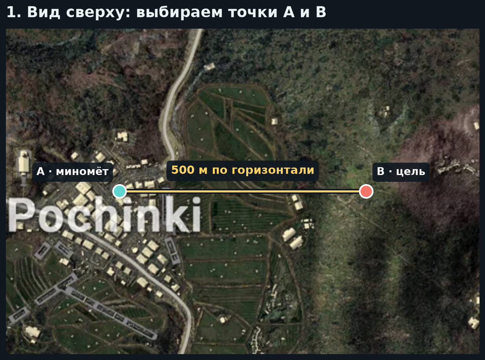
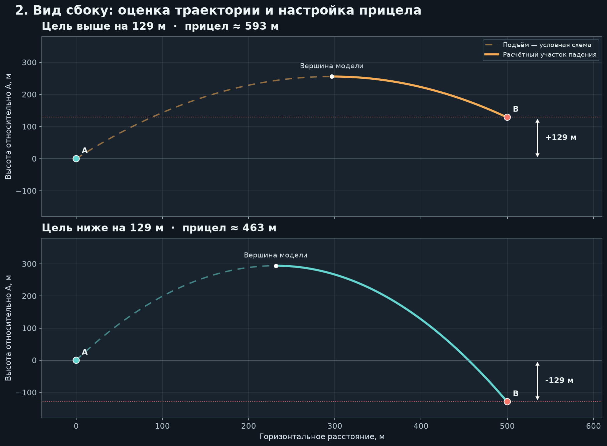

# 🎯 DROPZONE — PUBG Stats & Mortar Tools

**Статистика матчей, интерактивные карты и миномётный калькулятор PUBG: BATTLEGROUNDS в одном приложении.**

[Открыть сайт](https://95.174.95.143/pubg/) · [Миномётный калькулятор](https://95.174.95.143/pubg/#mortar) · [Секретные места](https://95.174.95.143/pubg/secret-rooms)


## О проекте

DROPZONE помогает разбирать сыгранные матчи и планировать миномётные выстрелы. Статистика и телеметрия поступают из официального PUBG API; карты, модель высот и вычисления работают внутри приложения. Интерфейс поддерживает мышь, касания и полноэкранный режим.

| | |
|---|---|
| **Основные языки** | Python и JavaScript; интерфейс — HTML и CSS |
| **Сервер и данные** | Flask, PUBG API, Pillow и OpenCV |
| **Запуск** | Docker Compose; Gunicorn внутри контейнера |
| **Объём исходников** | **3 243 строки** в 16 отслеживаемых файлах Python, JavaScript, HTML и CSS, включая тесты |
| **История** | **7 коммитов** на момент обновления README, 13 ноября 2026 г. |

Метрики — снимок на указанную дату. Строки подсчитаны по отслеживаемым файлам с расширениями `.py`, `.js`, `.cjs`, `.html`, `.css`, включая пустые строки и комментарии; данные карт и изображения не учитываются. Текущее число коммитов можно проверить командой `git rev-list --count HEAD`.

## Возможности

- **Разбор матча:** выбор тиммейта или ввод никнейма, статистика, маршруты игроков, траектория самолёта, ноки и убийства с оружием, приземлившиеся эйрдропы и круги безопасной зоны по фазам.
- **Миномётный калькулятор:** точки миномёта и цели, расстояние по горизонтали, перепад высот, прямое расстояние и оценка настройки прицела. Есть круг номинальной дальности 700 м и настраиваемый условный круг около цели.
- **Расчёт по скриншоту:** вставка из буфера или загрузка PNG, JPEG и WebP, выбор цвета игрока, автоматические подсказки и ручная корректировка точек. При необходимости карту можно совместить по двум ориентирам.
- **Секретные места:** интерактивные карты комнат и дверей, а также слои автомобилей и заправок. Старые точки дельтапланов доступны отдельным слоем: после обновления игры они могут быть неактуальны.
- **Windows Clipboard:** локальная программа отслеживает новые изображения в буфере и передаёт их калькулятору, открытому через программу.

Источники секретных мест — данные сообщества; список и координаты могут быть неполными или измениться после обновления игры. Метки стоит проверять в матче.

## Как работает миномётный расчёт

Обозначим точку миномёта **A**, точку цели **B** и перепад `Δh = высота B − высота A`.

### Пример: цель в 500 метрах



На карте показаны условные точки A и B на расстоянии 500 м по горизонтали. Для пояснения ниже возьмём два **гипотетических** перепада высот: цель на 129 м выше или на 129 м ниже. Эти высоты не являются измерениями в показанных точках карты.



На графиках ноль по высоте — уровень миномёта A, красная пунктирная линия — уровень цели B. Сплошной участок показывает рассчитанное моделью падение от вершины; пунктирный подъём нарисован **условно**, поскольку алгоритм его не моделирует. Для одной и той же горизонтальной дистанции модель предлагает прицел около **593 м** для цели выше и **463 м** для цели ниже.

Изображения создаются скриптом [`docs/create_mortar_diagrams.py`](docs/create_mortar_diagrams.py): значения прицела он получает из текущей функции калькулятора. Для повторного построения нужны Node.js, Pillow и matplotlib.

### Пошаговый расчёт

1. Координаты PUBG по осям X и Y заданы в сантиметрах. Приложение переводит их в метры и вычисляет горизонтальную дистанцию:

   ```text
   D = hypot(xB − xA, yB − yA) / 100
   Δh = hB − hA
   ```

2. Для обеих точек запрашиваются высоты рельефа. Прямое расстояние считается отдельно: `sqrt(D² + Δh²)`. **Это геометрическая дистанция, а не настройка прицела.**
3. Для настройки прицела используется приближённая модель сообщества из [mortarkiller_desktop](https://github.com/Ashimdude/mortarkiller_desktop): перебираются углы от 85,5° до 45,5° с шагом 0,5°. Каждому углу соответствует табличное значение игрового прицела `R`.
4. Для каждого угла вычисляются горизонтальная скорость и высота вершины траектории относительно цели:

   ```text
   vx = 151 × cos(θ)
   H  = (151² × sin²(θ)) / (2 × 32,16) − 17,8 − Δh
   ```

   Значения `151`, `32,16` и `−17,8` — параметры модели сообщества. Если `H < 0`, цель выше вершины расчётной траектории и такой вариант отбрасывается.
5. Падение моделируется от `R / 2` с шагом 0,01 секунды. Среди вариантов, где расчётная точка отличается от `D` меньше чем на 10 м, выбирается ближайший; затем угол уточняется шагом 0,1° с интерполяцией табличного прицела. Если подходящего варианта или данных высоты нет, сайт не подставляет выдуманное значение.

Например, при горизонтальном расстоянии **500 м** и цели **на 129 м выше** модель предлагает прицел около **593 м**; при цели **на 129 м ниже** — около **463 м**. Использовать нужно выделенное значение **«Установите прицел»**.

> Расчёт — **оценка, а не официальная физическая модель PUBG**. Точность зависит от выбранных точек, данных высот и актуальности модели; проверяйте результат пристрелкой. Рельеф не учитывает крыши и мосты. Круг 700 м показывает номинальную дальность на одном уровне, а круг у цели — пользовательский ориентир, не подтверждённый радиус игрового разброса.

Для девяти карт используются карты высот сообщества из [Mortarkiller](https://github.com/MingDMeng/mortarkiller) с билинейной интерполяцией; для Haven и тренировочного полигона данных высоты нет. Сведения об источниках находятся в [`terrain/sources.json`](terrain/sources.json).

## Быстрый запуск

Установите Docker и Docker Compose, затем создайте `.env` на основе [`.env.example`](.env.example) и укажите ключ из [PUBG Developer Portal](https://developer.pubg.com/).

```bash
cp .env.example .env
# Заполните PUBG_API_KEY в .env
docker compose up -d --build
```

В PowerShell вместо `cp` можно использовать `Copy-Item .env.example .env`. После запуска приложение доступно на **http://127.0.0.1:5000**. Контейнер намеренно привязан к локальному адресу; для публичного доступа используйте HTTPS reverse proxy. Не добавляйте `.env` и ключ API в Git.

Для размещения рядом с другим сайтом используйте пример [`deploy/nginx-pubg-shared.conf`](deploy/nginx-pubg-shared.conf) и ограничения запросов [`deploy/pubg-screenshot-limit.conf`](deploy/pubg-screenshot-limit.conf). На текущем сервере приложение доступно по `/pubg/`; настройки существующего сайта заменять не требуется. Подробнее — в [`deploy/README.md`](deploy/README.md).

## Автозагрузка скриншотов в Windows

1. Установите Pillow и запустите `python clipboard-helper/pubg_clipboard.py`.
2. Нажмите в программе **«Открыть калькулятор»**: сайт откроется через локальный адрес `127.0.0.1:18741`.
3. Выберите игровую карту и цвет игрока, затем скопируйте новый скриншот карты в буфер.
4. Проверьте автоматически найденные точки A и B; при необходимости исправьте их вручную.

Программа хранит последнее изображение в памяти до изменения буфера или закрытия. Скриншот передаётся на сервер приложения для распознавания; локальный поток доступен странице помощника. Для самостоятельной сборки Windows-программы можно установить PyInstaller и выполнить:

```bash
pyinstaller --onefile --windowed --name PUBG-Clipboard clipboard-helper/pubg_clipboard.py
```

Готовый `.exe` является результатом сборки и не хранится в репозитории.

## Проверки

```bash
python -m unittest -v test_telemetry test_screenshot
node test_mortar_math.cjs
node test_mortar_ballistics.cjs
```

Тесты проверяют телеметрию, доступность карт и высот, сопоставление скриншотов, геометрическую дистанцию и баллистическую модель для разных перепадов высот. Для локального запуска Python-тестов установите зависимости из `requirements.txt`; для JavaScript-тестов требуется Node.js.

## Источники

- [PUBG Developer Portal и API](https://developer.pubg.com/) · [ресурсы карт и оружия PUBG API](https://github.com/pubg/api-assets).
- [Mortarkiller Desktop](https://github.com/Ashimdude/mortarkiller_desktop) — модель миномётной траектории и таблица прицела.
- [Mortarkiller](https://github.com/MingDMeng/mortarkiller) — исходные карты высот сообщества.
- [SenseOS: интерактивная карта](https://senseos.gg/wiki/pubg-battlegrounds/interactive-map/) — данные сообщества о секретных местах и транспорте. Старые точки дельтапланов не гарантируют появления после обновления 43.2.

Проект создан сообществом и не является официальным продуктом KRAFTON или PUBG Studios.
